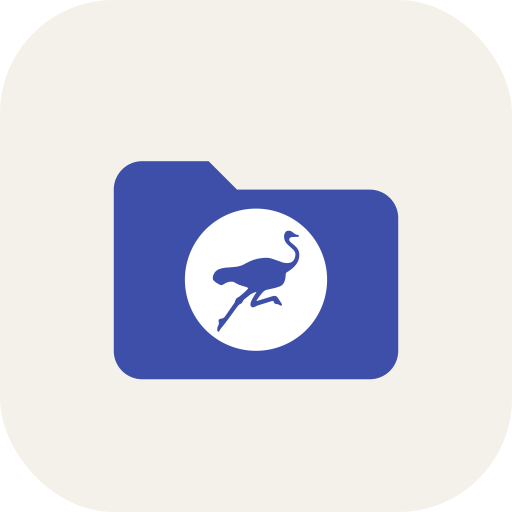

# Tansu

Explorador de los datos que tus apps de Nostr guardan en tu cuenta: copias de seguridad y ajustes (NIP-78) y listas (NIP-51). Para Android, con varias cuentas a la vez.
*A file explorer for the data your Nostr apps keep in your account. Català · Español · English.*

> Estado: **beta** ([Tansu Beta](https://github.com/oluengo/tansu/releases/tag/tansu-beta)).

## Privado por diseño

- **Nunca publica nada legible.** Todo lo que Tansu escribe va cifrado con NIP-44 para la propia cuenta. Los datos sin cifrar se pueden ver, pero no editar.
- **Nunca ve tu nsec.** Firma y cifra Amber (NIP-55) o un bunker (NIP-46). También se puede añadir una npub en solo lectura.
- Lo descifrado solo vive en memoria mientras la app está abierta.

## Qué hace

- **Varias cuentas** (Amber, bunker o npub) y cambio rápido entre ellas.
- **Carpetas por app**: Wavestr, Usus, Mado… según el prefijo de la etiqueta `d` (`wavestr/favorites`, `usus/backup`).
- **Copias por partes** (formato de Usus: índice + partes comprimidas): se ven como un solo archivo.
- **Descifrar, ver, editar** (JSON validado), **exportar a archivo**, **copiar a otra cuenta** (se vuelve a cifrar para ella) y **eliminar** (NIP-09).
- **Papelera local**: antes de borrar o sobrescribir se guarda una copia (cifrada) para poder restaurarla.
- **Listas NIP-51**: ver (también la parte privada) y editar. Lo nuevo siempre va a la parte privada, cifrada; lo público solo se puede quitar o hacer privado.
- Tema claro/oscuro/auto, color de acento, tres idiomas y relays editables.

## Instalar la beta

La beta se instala como otra app, **Tansu Beta**, con sus propios datos. Puede tener fallos.

- **Obtainium:** añade `https://github.com/oluengo/tansu` y activa «incluir pre-releases».
- **Directo:** descarga el APK de la [pre-release Tansu Beta](https://github.com/oluengo/tansu/releases/tag/tansu-beta).

Comprueba que la huella del certificado coincide (también está en Ajustes → Acerca de):
`E3:71:51:7A:B8:5F:4F:82:3C:D5:7D:79:9B:DF:11:72:E3:3D:C9:96:B2:FF:9D:4E:9B:F5:F6:BA:1E:D1:77:99`

## Desarrollo

Kotlin + Jetpack Compose (Material 3), sin dependencias de Nostr: cliente de relays, NIP-44, NIP-46 y firmas propios (vienen de Wavestr). Módulo `:core` (JVM, con tests) y `:app` (Android).

- Plan y decisiones: [`docs/`](docs/plan-tecnico.md)
- Demo HTML de la interfaz: [`demo/index.html`](demo/index.html)

Créditos en [CREDITS.md](CREDITS.md). Licencia [MIT](LICENSE).
